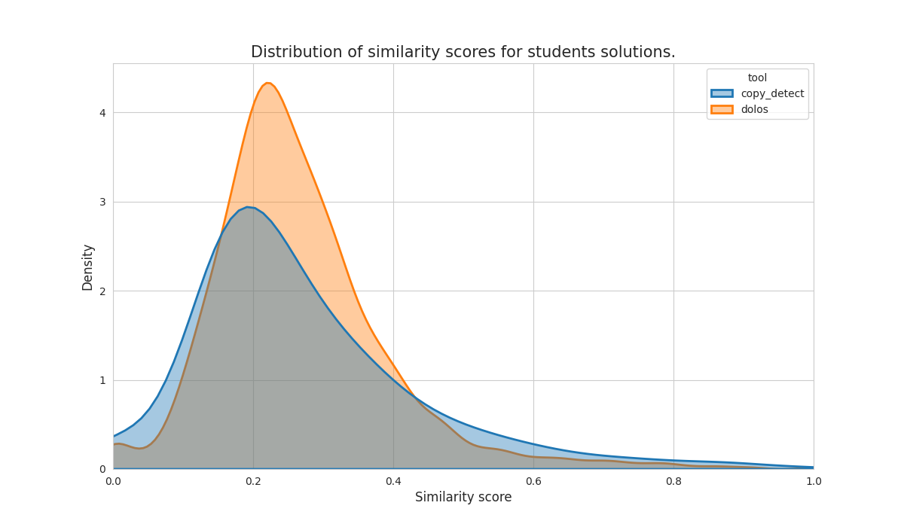
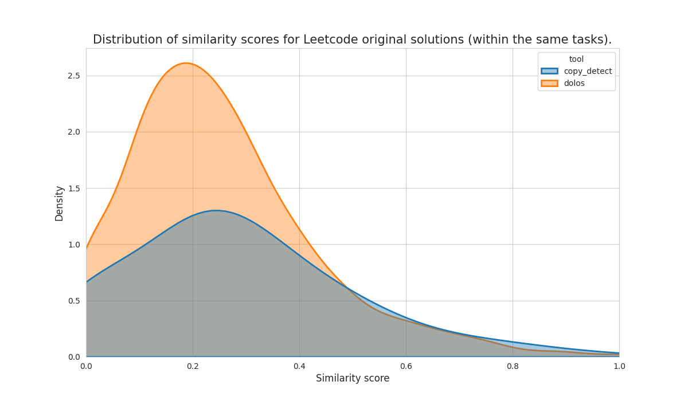
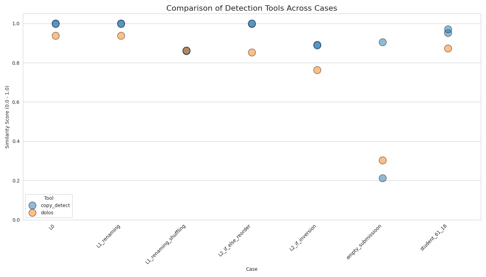

# Plagiarism Detection Tools Comparison (CSEDU 2026)

This repository contains the code, data and experiment scripts for the paper **"Comparative Analysis of Non-Commercial Plagiarism Detectors for Computer Science Education"**, presented at the 18th International Conference on Computer Supported Education ([CSEDU 2026](https://csedu.scitevents.org/Home.aspx)), Benidorm, Spain.

**Authors:** Paulina Gacek, Bartosz Gdowski, Konrad Szymański, Wojciech Żmuda
(AGH University of Krakow, Faculty of Electrical Engineering, Automatics, IT and Biomedical Engineering)

Original repository (private): `sprawdzarka-aisd/plagiarism-detection-tools-comparison`

## My contribution

I did a detailed technical analysis of the Dolos detector and wrote automation scripts for generating the test data. I am also a co-author of the paper.

## About the research

We compared four non-commercial plagiarism detectors: **MOSS, JPlag, Dolos** and **copydetect**, on three datasets:

1. **Dataset A (academic corpus):** 102 real student submissions, used to check how well each tool ignores boilerplate code.
2. **Dataset B (algorithmic discrimination):** 252 LeetCode problems with different correct solutions to the same task, used to measure false positives.
3. **Dataset C (obfuscation resilience):** synthetic pairs with four levels of obfuscation (formatting, lexical, structural and semantic changes).

**Key findings:**
- **JPlag and MOSS** had the fewest false positives but were vulnerable to structural obfuscation.
- **copydetect** was the most robust against obfuscation, but its threshold needs careful calibration to avoid false positives.
- **Dolos** has the best cluster visualisations, which makes it the most useful tool for finding groups of students who worked together.

## Repository structure

```
data/solutions/all_students     Dataset A
data/boilerplate                boilerplate code given to students (used as MOSS base file)
data_leetcode/                  Dataset B, one folder per problem
data/solutions/specific_cases   Dataset C
scripts/                        one runner per tool + main.py and charts
results/                        raw similarity scores and charts
```

## Setup

### 1. Python
```bash
python3 -m venv .venv
source .venv/bin/activate
pip install -r requirements.txt
cp .env.example .env    # then fill in the values
```

### 2. MOSS
MOSS needs a free user ID: send an e-mail as described on the [MOSS website](https://theory.stanford.edu/~aiken/moss/) and put the ID in `.env` as `MOSSID`.

### 3. JPlag
JPlag needs Java 21 or newer. Download `jplag-x.y.z-jar-with-dependencies.jar` from the [JPlag releases](https://github.com/jplag/JPlag/releases), save it as `tools/jplag.jar` (or set `JPLAG_JAR` in `.env`).

### 4. Dolos
Dolos needs Node.js 20:
```bash
nvm install 20
nvm use 20
npm install -g @dodona/dolos
dolos --version
```
If something goes wrong, see the [Dolos installation guide](https://dolos.ugent.be/docs/installation.html).

## Running

```bash
python3 scripts/main.py
```

Choose which tools to run in the `tool_to_runner` dictionary in `scripts/main.py`. Each tool returns pairwise similarity scores in the range 0.0–1.0. Results that already exist in `results/` are not generated again; delete a file to recompute it.

## Results

| Dataset A: student submissions | Dataset B: LeetCode | Dataset C: obfuscation |
| --- | --- | --- |
|  |  |  |